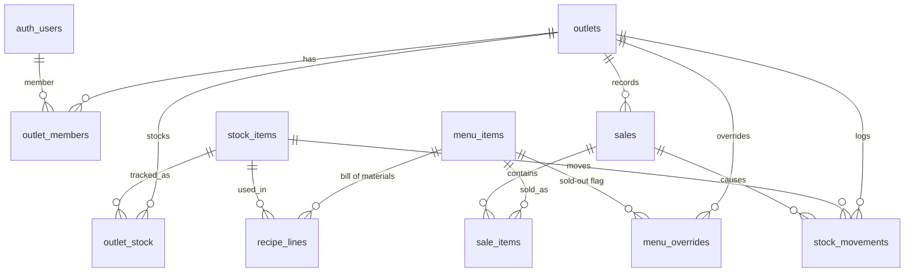
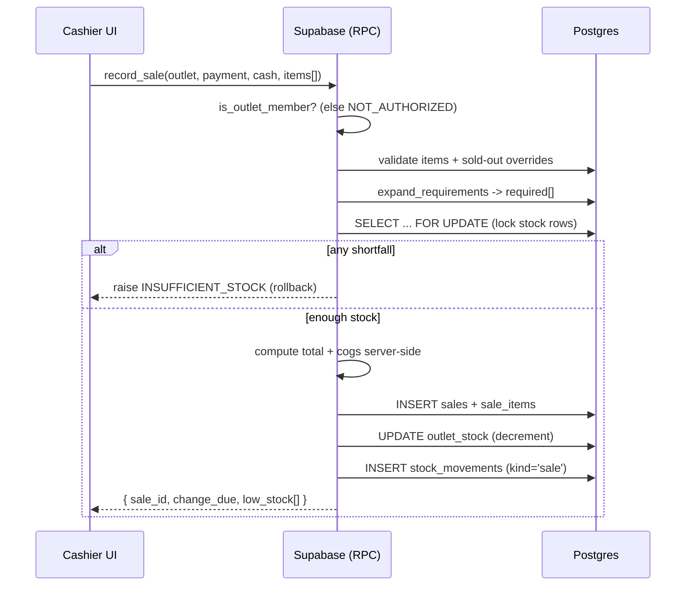

# KeCup — Supabase Backend Design

Postgres + Row-Level Security + transactional stored procedures, delivered as four ordered migration files pasted into the Supabase SQL Editor (a human step — the executor cannot reach the project). This doc specifies the schema (full DDL), security model, function **contracts** (signatures + behavior + error codes), the sale flow, and the seed/verify scripts. The full bodies of the PL/pgSQL functions are written during Task 11; their contracts here are authoritative so a smaller model can implement them without drifting.

> **Golden rule:** the client is never trusted for prices or stock math. `record_sale` recomputes totals and COGS server-side from the menu + stock tables. Insufficient stock **rolls back the whole transaction**.

---

## 1. Entity-relationship model



- **Brand-level, read-only to clients:** `menu_items`, `recipe_lines`, `stock_items`.
- **Per-outlet, member-writable (via RPC only):** `outlet_stock`, `sales`, `sale_items`, `stock_movements`, `menu_overrides`.
- **Access control:** `outlet_members` (user ↔ outlet, with role).

## 2. Schema — `0001_schema.sql`

```sql
-- Brand-level reference data -------------------------------------------------
create table menu_items (
  id          text primary key,
  kind        text not null check (kind in ('snack','drink','combo')),
  name        text not null,
  price       integer not null,                 -- rupiah
  compare_price integer,                         -- combos only (a-la-carte total)
  flavor_key  text,
  drink_key   text,                              -- default drink for combos
  photo_key   text,
  sort_order  integer not null default 0,
  active      boolean not null default true
);

create table stock_items (
  id        text primary key,
  name      text not null,
  category  text not null check (category in ('food','drink','packaging')),
  unit      text not null default 'portion'
);

create table recipe_lines (
  menu_item_id  text not null references menu_items(id) on delete cascade,
  stock_item_id text not null references stock_items(id) on delete restrict,
  qty           numeric not null check (qty > 0),
  primary key (menu_item_id, stock_item_id)
);

-- Outlets & membership -------------------------------------------------------
create table outlets (
  id          uuid primary key default gen_random_uuid(),
  slug        text unique not null,
  name        text not null,
  area        text,
  address     text,
  maps_query  text,
  whatsapp    text,                              -- placeholder until real number
  instagram   text,
  hours       jsonb not null,                    -- per-weekday {open,close,closed}
  line_order  integer not null default 0,        -- Craving Line position
  is_flagship boolean not null default false,
  temporarily_closed boolean not null default false,
  created_at  timestamptz not null default now()
);

create table outlet_members (
  outlet_id uuid not null references outlets(id) on delete cascade,
  user_id   uuid not null references auth.users(id) on delete cascade,
  role      text not null default 'staff' check (role in ('owner','staff')),
  primary key (outlet_id, user_id)
);

-- Per-outlet inventory -------------------------------------------------------
create table outlet_stock (
  outlet_id     uuid not null references outlets(id) on delete cascade,
  stock_item_id text not null references stock_items(id) on delete restrict,
  qty           numeric not null default 0,
  low_threshold numeric not null default 0,
  unit_cost     numeric not null default 0,      -- per-outlet purchase cost
  primary key (outlet_id, stock_item_id)
);

-- Sales ----------------------------------------------------------------------
create table sales (
  id            uuid primary key default gen_random_uuid(),
  outlet_id     uuid not null references outlets(id) on delete cascade,
  cashier_id    uuid references auth.users(id),
  payment_method text not null check (payment_method in ('cash','qris')),
  total         integer not null default 0,
  cogs          numeric not null default 0,
  cash_received integer,
  change_due    integer,
  order_code    text,
  voided        boolean not null default false,
  voided_at     timestamptz,
  voided_by     uuid references auth.users(id),
  void_reason   text,
  created_at    timestamptz not null default now()
);

create table sale_items (
  id          uuid primary key default gen_random_uuid(),
  sale_id     uuid not null references sales(id) on delete cascade,
  menu_item_id text not null references menu_items(id),
  drink_choice text,                             -- combos: 'tea-cloudy' | 'tea-fizzy'
  qty         integer not null check (qty > 0),
  unit_price  integer not null,
  line_cogs   numeric not null default 0
);

-- Movement ledger ------------------------------------------------------------
create table stock_movements (
  id            uuid primary key default gen_random_uuid(),
  outlet_id     uuid not null references outlets(id) on delete cascade,
  stock_item_id text not null references stock_items(id),
  kind          text not null check (kind in ('sale','restock','adjustment','waste','void','seed')),
  delta         numeric not null,                -- negative = out
  ref_sale_id   uuid references sales(id),
  note          text,
  created_at    timestamptz not null default now()
);

-- Manual sold-out overrides --------------------------------------------------
create table menu_overrides (
  outlet_id     uuid not null references outlets(id) on delete cascade,
  menu_item_id  text not null references menu_items(id) on delete cascade,
  sold_out      boolean not null default false,
  updated_at    timestamptz not null default now(),
  primary key (outlet_id, menu_item_id)
);

-- Indexes
create index on sales (outlet_id, created_at);
create index on sale_items (sale_id);
create index on stock_movements (outlet_id, created_at);
create index on outlet_stock (outlet_id);
```

*(Optional stretch — `prep_recipes` / `prep_recipe_lines` to derive prepared-item costs from raw ingredients. Out of scope for the 2-day build; keep costing in `data/costing.ts` instead.)*

## 3. Security & RLS — `0002_security_rls.sql`

```sql
-- Membership helper (security definer, locked search_path)
create or replace function is_outlet_member(p_outlet uuid)
returns boolean language sql security definer set search_path = '' as $$
  select exists (
    select 1 from public.outlet_members m
    where m.outlet_id = p_outlet and m.user_id = auth.uid()
  );
$$;

-- Enable RLS everywhere
alter table outlets         enable row level security;
alter table outlet_members  enable row level security;
alter table menu_items      enable row level security;
alter table stock_items     enable row level security;
alter table recipe_lines    enable row level security;
alter table outlet_stock    enable row level security;
alter table sales           enable row level security;
alter table sale_items      enable row level security;
alter table stock_movements enable row level security;
alter table menu_overrides  enable row level security;

-- Public read: brand data + outlets (so the public site works anonymously)
create policy pub_read_menu   on menu_items   for select using (true);
create policy pub_read_stocki on stock_items  for select using (true);
create policy pub_read_recipe on recipe_lines for select using (true);
create policy pub_read_outlet on outlets      for select using (true);

-- Overrides: public read (drives sold-out badges), member write only
create policy pub_read_ovr on menu_overrides for select using (true);
create policy mem_write_ovr on menu_overrides for all
  using (is_outlet_member(outlet_id)) with check (is_outlet_member(outlet_id));

-- Member-scoped read on operational tables
create policy mem_read_members on outlet_members for select using (is_outlet_member(outlet_id));
create policy mem_read_stock   on outlet_stock   for select using (is_outlet_member(outlet_id));
create policy mem_read_sales   on sales          for select using (is_outlet_member(outlet_id));
create policy mem_read_salei   on sale_items     for select
  using (exists (select 1 from sales s where s.id = sale_items.sale_id and is_outlet_member(s.outlet_id)));
create policy mem_read_moves   on stock_movements for select using (is_outlet_member(outlet_id));

-- Outlet profile: members may update only their row
create policy mem_update_outlet on outlets for update
  using (is_outlet_member(id)) with check (is_outlet_member(id));

-- outlet_stock: members may edit ONLY low_threshold + unit_cost directly;
-- qty changes happen through RPCs. Enforce via column GRANTs:
revoke all on outlet_stock from authenticated, anon;
grant select on outlet_stock to authenticated;
grant update (low_threshold, unit_cost) on outlet_stock to authenticated;

-- All qty-mutating writes go through SECURITY DEFINER RPCs (see 0003).
```

Notes:
- `service_role` bypasses RLS (used only by the seed script, server-side).
- `create policy` is not idempotent — wrap migrations so re-runs don't error (drop-if-exists, or run once).
- Realtime (next section) only publishes **public** tables, so anon subscribers can't leak private data.

## 4. Functions — `0003_functions.sql`

All are `security definer` with `set search_path = ''`, `execute` revoked from `public`/`anon` and granted to `authenticated` (except the public availability function). Every function first verifies membership and raises `NOT_AUTHORIZED` if the caller is not a member of the target outlet.

### `expand_requirements(items jsonb) returns table(stock_item_id text, qty numeric)`
Pure helper. Takes `[{menu_item_id, drink_choice?, qty}]`, expands each line into stock requirements, and **groups by `stock_item_id`** to aggregate duplicates. Combo expansion: non-packaging lines of the snack + non-packaging lines of the chosen drink + the combo's own `pack-stack` line. Validates that `drink_choice` references an actual drink. Used by `record_sale` and analytics; the TS twin is `lib/recipes.ts#expandRequirements` and a test asserts they agree.

### `record_sale(p_outlet uuid, p_payment text, p_cash integer, p_items jsonb) returns jsonb`
Atomic POS transaction:
1. Check `is_outlet_member(p_outlet)` → else `NOT_AUTHORIZED`.
2. Validate `p_payment ∈ {cash,qris}` and that every `menu_item_id` exists and is active.
3. Reject any item with an active `menu_overrides.sold_out = true` → `SOLD_OUT`.
4. `expand_requirements` → aggregate required qty per stock item.
5. **Lock** the relevant `outlet_stock` rows (`for update`) to prevent concurrent oversell.
6. Compare required vs on-hand; if any shortfall → raise `INSUFFICIENT_STOCK` (transaction rolls back).
7. Compute `total` and `cogs` **server-side** from `menu_items.price` and `outlet_stock.unit_cost` (combo price is fixed regardless of drink).
8. For `cash`, require `p_cash >= total` → else `INSUFFICIENT_CASH`; compute `change_due`.
9. Insert `sales` + `sale_items` (with `line_cogs`), decrement `outlet_stock.qty`, insert negative `stock_movements` (`kind='sale'`, `ref_sale_id`).
10. Return `{ sale_id, total, change_due, low_stock: [stock_item_id...] }` (items that fell below `low_threshold`).

Implemented with CTEs + `jsonb_to_recordset` in a single statement path where possible (each RPC call is its own transaction, so no temp tables needed).

### `void_sale(p_sale uuid, p_reason text) returns void`
Membership check; reject if already voided (`ALREADY_VOIDED`); reverse each sale movement by inserting compensating `stock_movements` (`kind='void'`) and restoring `outlet_stock.qty`; stamp `voided`, `voided_at`, `voided_by`, `void_reason`. Voided sales are excluded from analytics.

### `restock_stock(p_outlet uuid, p_item text, p_qty numeric, p_unit_cost numeric default null, p_note text default null) returns void`
Membership check; increment `qty`; if `p_unit_cost` given, update `unit_cost` as a **weighted average** against existing on-hand (fall back to the new cost if on-hand is 0); log `stock_movements` (`kind='restock'`).

### `adjust_stock(p_outlet uuid, p_item text, p_delta numeric, p_kind text, p_note text default null) returns void`
Membership check; `p_kind ∈ {adjustment, waste}`; **waste must be negative**; apply delta; log movement. (Delta-based so it handles both manual recounts and waste.)

### `get_outlet_stock_flags(p_slug text) returns table(stock_item_id text, in_stock boolean)` — **public**
`execute` granted to `anon` + `authenticated`. Returns a **boolean per stock item** — `qty >=` the largest single-unit requirement across all recipes using that item — so at least one dependent item is makeable. **Does not expose raw quantities.** Missing stock rows map to `false` on the TS side (untracked = unavailable). The shared `lib/recipes.ts#checkAvailability` combines these flags with `menu_overrides` to compute final per-item availability (including combo logic).

## 5. Realtime — `0004_realtime.sql`

```sql
alter publication supabase_realtime add table outlets;
alter publication supabase_realtime add table menu_overrides;
```

The public site subscribes to `outlets` (temporary-closure, hours) and `menu_overrides` (sold-out) and invalidates the relevant TanStack Query keys on change — so toggling "sold out" in the portal updates the public menu live. Availability itself is a function, not a table, so we subscribe to its *inputs*. Both tables are public-readable, so anon subscribers are fine. Flagged as nice-to-have within Task 17.

## 6. Sale-recording sequence



## 7. TypeScript integration (`src/lib/supabase.ts`)

- Create the client with session persistence + auto-refresh; read `VITE_SUPABASE_URL` + `VITE_SUPABASE_PUBLISHABLE_KEY`; expose an `isConfigured` flag so the public site falls back to static data when envs are absent (resilient demo).
- Hand-write DB types (don't rely on the Supabase CLI, which needs login/Docker).
- RPC wrapper parses the `INSUFFICIENT_STOCK` / `SOLD_OUT` / `NOT_AUTHORIZED` error messages into typed results; coerce numeric columns with `Number()` defensively.
- Pagination helper: fetch in batches of 1000 via `.range()` (PostgREST caps single requests at 1000; seed produces ~1200 sales).

## 8. Seed script (`scripts/seed.ts`, run with `tsx` + `--env-file=.env.local`)

- Uses the **service-role key** (bypasses RLS); **server-side only**, gitignored.
- Idempotent: upsert outlets, memberships, stock; create the demo auth user via the admin API; `--reset` flag to wipe sales first.
- Generates ~30 days / ~1200 synthetic sales per the model in [`DATA-MODEL.md` §9](./DATA-MODEL.md) using the deterministic PRNG; computes COGS with the same TS functions the app uses; converts Asia/Jakarta local times to UTC ISO timestamps.
- Sets final stock levels directly (and nudges low/zero items for demos); inserts seed movements to initialize the ledger; applies stock-based sold-out overrides.
- Prints a summary table with demo credentials + totals.
- Demo account: `anggrek.franchisee@example.com`, password from `SEED_DEMO_PASSWORD`.

## 9. Verify script (`scripts/verify-backend.ts`)

Signs in with the **publishable** key + demo credentials and asserts:
1. Anon sees `outlets` + stock **flags** but **no** `sales` rows (RLS holds).
2. Signed-in demo user sees only their own outlet's data — a cross-tenant `sales` read returns nothing.
3. `record_sale` decrements exactly the expected stock items/qty.
4. Returned COGS matches `computeCogs` within tolerance.
5. `void_sale` restores stock.
6. A cross-tenant `record_sale` fails with `NOT_AUTHORIZED`.
7. A direct `update outlet_stock set qty = ...` is **blocked** by column grants.

Exits non-zero on any failure; prints a pass/fail report (this is the demo for Task 11).

## 10. Security notes

- The **publishable** (`anon`) key is meant to be public; RLS is the real access control. Keep RLS enabled on **every** table.
- The **secret / service-role** key must never appear in a `VITE_` var, in client code, or in git. It lives in `.env.local` for seeding only.
- **Disable public sign-ups** in Supabase Auth; set a strong password policy. Password login needs no email-redirect config.
- The portal is network-exposed; auth is Supabase + RLS. Flag in docs: a network-exposed back-office exists.
- The **demo login button** ships a public password — anyone can log in and tamper with demo data. Keep the reseed script handy and/or gate the demo button behind an env flag for any non-throwaway deployment.
