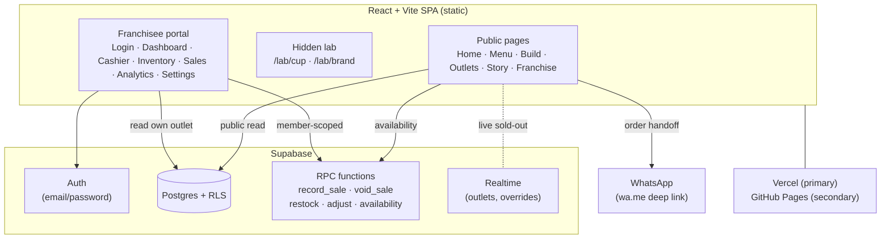

# KeCup — Implementation Plan

> **Status:** Planning complete, ready to execute.
> **Project type:** University "Venture Creation" project (F&B + Computer Science component).
> **Brand:** KeCup — wordplay on Indonesian *kecup* (a little kiss / smacking kiss sound) and *cup*.
> **Tagline:** **"Keep Cravings in One Cup"** (kept in English in both locales).
> **Product:** Nachos (Bolognese / Mushroom / Cheese sauce) stacked on top of a tea drink (Cloudy cheese-foam tea / Fizzy tea) in one connected stacked cup — snack on top, sip below, one hand.

This document is the master plan. Companion docs:

| Doc | Covers |
|-----|--------|
| [`DESIGN.md`](./DESIGN.md) | Brand/design system, animation & interaction patterns, per-page specs, 3D cup implementation |
| [`DATA-MODEL.md`](./DATA-MODEL.md) | Menu, costing/HPP, recipes, stock, outlets, franchise packages, business logic |
| [`BACKEND.md`](./BACKEND.md) | Supabase schema, RLS, SQL functions, seed/verify scripts, sale flow, security |
| [`CONTENT.md`](./CONTENT.md) | Bilingual copy deck (EN/ID), WhatsApp templates, asset shot list |

---

## 1. Problem statement

Build a web presence for KeCup that (a) looks genuinely impressive for a brand pitch, with heavy, tasteful animation and non-generic layouts, and (b) carries a real Computer Science component so it satisfies the course requirement. The site has three parts:

1. **Public brand site** — markets the product, lets customers browse the menu, build a custom cup, and send an order through WhatsApp. Includes a franchise ("Work With Us") pitch.
2. **Franchisee portal** — a real, authenticated back-office: cashier (point-of-sale) that records sales and *deducts inventory by recipe*, inventory management, sales history, analytics (revenue, margins, HPP, payback), and outlet settings that push live sold-out status to the public site.
3. **Supabase backend** — Postgres with Row-Level Security, transactional stored procedures for sales, and seeded demo data so analytics look real on demo day.

The CS depth lives mostly in the portal + backend (multi-tenant RLS, transactional inventory deduction, analytics), while the "wow" lives in the public site (3D cup, scroll choreography).

## 2. Goals & non-goals

**Goals**
- A polished, memorable public site with a 3D cup, scroll-driven storytelling, and a working cup builder that hands off to WhatsApp.
- A functioning multi-tenant portal demonstrating auth, authorization (RLS), transactional POS, and analytics.
- Bilingual (English / Bahasa Indonesia).
- Deployable to Vercel (primary) and GitHub Pages (secondary), both free.
- Accurate unit-economics tied to the team's real HPP numbers.

**Non-goals**
- No server-side rendering / SEO optimization (SPA is fine).
- No real payment gateway (orders go via WhatsApp; portal POS records cash/QRIS only).
- No native mobile app (responsive web only).
- Real franchise/outlet data beyond BINUS Anggrek is **fictional** and labelled as such.

## 3. Open questions / flags for the team

These were surfaced during planning and should be confirmed. Execution can proceed with the stated assumptions; adjust later via the portal.

1. **Bolognese Nachos pricing.** À-la-carte HPP is Rp 15.900 against Rp 25.000 = **63.6%**, above the 60% target. To hit 60% the price needs to be **≥ Rp 26.500**. (The site flags this automatically in the analytics "pricing insights" card.)
2. **Golden Cheese Nachos** is borderline at **60.9%** (Rp 10.350 / Rp 17.000). Suggested ≥ Rp 17.500.
3. **Fizzy Tea has no cost breakdown.** Assumed HPP = Cloudy Tea (Rp 4.840, with a Rp 2.600 base). Replace with the real figure in the portal when known.
4. **Menu typo:** "Frizzy Tea" on menu-1 → standardized to **"Fizzy Tea"** everywhere (matches menu-2).
5. **Placeholder contact details.** WhatsApp numbers and partnership email are fake placeholders; the WhatsApp order button will not reach anyone until replaced.
6. **Scope realism.** 25 tasks is ambitious for a ~2-day sprint. The task order is deliberately "skeleton first, wow last" so there is always a shippable site even if the final polish tasks are cut.
7. **Demo login button** exposes a public password for the demo franchisee account. Anyone could log in and alter demo data. Keep a reseed script handy and/or disable the demo button for any "real" deployment.

## 4. Requirements

**Functional**
- Browse menu (à la carte + combos) with per-outlet live sold-out status.
- Build a custom cup (sauce + sip, optional combo), see live price with savings vs à la carte, and send the order to WhatsApp with a pre-filled message.
- View outlets with live open/closed status (Asia/Jakarta time) and Google Maps links.
- Franchise pitch with an illustrative earnings calculator and an apply form (→ WhatsApp or email).
- Portal: email/password login; cashier records a sale (atomic: insert + inventory deduction + COGS); inventory restock/adjust/waste with a movement ledger; sales history with void + CSV export; analytics; outlet settings (hours, sold-out toggles, temporary closure) that sync live to the public site.

**Non-functional**
- Responsive, mobile-first (most traffic from an Instagram bio link).
- Accessible: semantic landmarks, keyboard navigable, focus rings, color contrast (see [`DESIGN.md`](./DESIGN.md)).
- Respect `prefers-reduced-motion` — a calm variant of every animation.
- Resilient demo: static fallback data if Supabase (free tier) is paused.
- All user-facing strings go through i18n in both languages (enforced by a parity test).

## 5. System architecture



- The frontend is a **static SPA** — no custom server. All dynamic behavior is Supabase (auth, Postgres, RLS, RPC, Realtime) or client-side.
- Public pages read public tables directly and call read-only availability RPCs. Orders never touch the DB — they hand off to WhatsApp.
- The portal is network-exposed but protected by Supabase Auth + RLS; the publishable key is safe to ship, the secret key is server-side only (see [`BACKEND.md` §Security](./BACKEND.md)).

## 6. Tech stack

Install **latest stable** of each and **pin exact versions**. Resolve any `ERESOLVE` peer conflicts by adjusting versions, never `--force`. Expected majors:

| Area | Choice | Notes |
|------|--------|-------|
| Build | **Vite** + React 19 + TypeScript | `create-vite react-ts`. See scaffolding gotcha §9. |
| Styling | **Tailwind v4** (`@tailwindcss/vite`) | Tokens in `@theme` in `globals.css`. |
| 3D | **three.js + @react-three/fiber v9 + @react-three/drei v10** | Verify R3F v9 peer range vs React 19.x before locking; stay on v9 (v10 not stable enough, most references target v9). |
| Scroll/scroll-anim | **GSAP** (ScrollTrigger, SplitText, DrawSVG, MorphSVG, MotionPath, Draggable, InertiaPlugin, Flip, CustomEase) + **Lenis** | All GSAP plugins are free now. Lenis only mounts in the public layout. |
| UI motion | **Motion** (framer-motion successor) | Modals, builder steps, layout animations. Clear division: GSAP = scroll/3D/SVG; Motion = component UI. |
| Routing | **React Router v7** | `createBrowserRouter` from `react-router`; `RouterProvider` from `react-router/dom`. |
| i18n | **react-i18next** | EN + ID bundled JSON; detect from localStorage → browser locale. |
| Backend SDK | **@supabase/supabase-js** | Auth + Postgres + RPC + Realtime. |
| Data fetching | **TanStack Query v5** | Caching, invalidation on realtime events. |
| State | **Zustand v5** | Cart, with `persist` middleware. |
| Forms | **react-hook-form + Zod v4** + resolver | Apply form, settings. |
| Charts | **Recharts** | Works with React 19. |
| UI primitives | **Radix UI** + **Sonner** (toasts) | Hand-styled, **not** the shadcn CLI (interactive-prompt risk in non-interactive shell). |
| Icons | **lucide-react** + custom SVG | |
| Fonts | **@fontsource** (self-hosted) | Fredoka (headlines, variable), Lilita One / Bagel Fat One (chunky marquee), Sacramento (script "cravings"), Plus Jakarta Sans (body), Space Mono (receipts/cashier). |
| Tests | **Vitest + React Testing Library**, **Playwright** (e2e) | Mock R3F/Canvas in jsdom. |
| Seed/scripts | **tsx** | Run TS directly in Node for seed + verify. |

**Deliberately excluded:** `leva` (peer risk w/ React 19 — build tiny lab controls instead), `r3f-perf` (use drei `Stats`/`PerformanceMonitor`), `date-fns` (custom Asia/Jakarta helpers).

## 7. Folder structure

```
kecup_site/
├─ docs/                      # these plan files
│  ├─ PLAN.md DESIGN.md DATA-MODEL.md BACKEND.md CONTENT.md
├─ public/
│  ├─ brand/                  # logo.jpeg, menu-1.jpeg, menu2.jpeg (moved here)
│  ├─ favicon.svg             # lips SVG
│  ├─ 404.html                # copy of index.html for GH Pages SPA routing
│  └─ .nojekyll
├─ supabase/
│  └─ migrations/
│     ├─ 0001_schema.sql
│     ├─ 0002_security_rls.sql
│     ├─ 0003_functions.sql
│     └─ 0004_realtime.sql
├─ scripts/
│  ├─ seed.ts                 # tsx, service-role, deterministic PRNG
│  ├─ verify-backend.ts       # RLS + RPC integration checks
│  └─ copy-404.ts             # post-build 404.html copy
├─ src/
│  ├─ main.tsx router.tsx
│  ├─ styles/globals.css      # Tailwind v4 @theme tokens
│  ├─ config/site.ts          # brand constants, contacts, CUP_STYLE default
│  ├─ data/                   # pure, framework-free, relative imports only
│  │  ├─ menu.ts stock.ts recipes.ts outlets.ts packages.ts costing.ts photos.ts
│  ├─ lib/                    # pure logic (TDD)
│  │  ├─ money.ts wib.ts hours.ts recipes.ts pricing.ts whatsapp.ts
│  │  ├─ franchise.ts prng.ts analytics.ts supabase.ts
│  ├─ i18n/ en.json id.json index.ts
│  ├─ hooks/ useReducedMotion.ts useTouch.ts useOutletLive.ts useAvailability.ts
│  ├─ anim/ gsap.ts (central plugin registration) lenis.tsx TransitionLink.tsx
│  ├─ three/
│  │  ├─ CanvasShell.tsx materials.ts geometry.ts gradientMap.ts
│  │  ├─ KeCupModel.tsx parts/ (Cup Tray Chips Sauce Drink Ice Bubbles Straw)
│  │  └─ scenes/ HeroScene FlavorScene BuilderScene FranchiseGrid
│  ├─ components/
│  │  ├─ brand/ Lips Sparkle CheckerBand Arch Wordmark Drip Sticker PriceTag
│  │  │          Placeholder GrainOverlay Marquee Badge Card
│  │  ├─ ui/     (Radix wrappers: Dialog Tabs Select Switch Accordion Tooltip + inputs)
│  │  └─ layout/ PublicNav PublicFooter PortalSidebar
│  ├─ pages/ public/ (Home Menu Build Outlets OutletDetail Story Franchise NotFound)
│  │         lab/ (CupLab BrandLab)
│  │         portal/ (Login Dashboard Cashier Inventory Sales Analytics Settings)
│  └─ store/ cart.ts
├─ e2e/ *.spec.ts
├─ .env.local  .env.example  (gitignored)
├─ vite.config.ts  (+ vitest config inline)  playwright.config.ts
├─ vercel.json  .github/workflows/deploy-pages.yml
└─ package.json  tsconfig*.json  eslint.config.js
```

See [`DATA-MODEL.md`](./DATA-MODEL.md) for the contents of `data/` and [`BACKEND.md`](./BACKEND.md) for `supabase/` and `scripts/`.

## 8. Task breakdown

Ordering principle: **working skeleton first → backend early (runs in parallel, ~minutes of human setup) → deploy early to catch base-path issues → 3D and the "wow" layer last.** Each task ends wired into navigation (no orphan pages) and meets the Definition of Done (§10).

| # | Task | Demo / done when |
|---|------|------------------|
| 1 | **Scaffold** Vite+React19+TS, Tailwind v4, Vitest, Playwright, ESLint, Prettier, path aliases. Move brand images → `public/brand/`. Save these docs. `src/lib/asset.ts` (+test) for base-path-safe URLs. | `dev` shows a cream page with "KeCup" in red Fredoka + logo; `build`/`test`/`lint`/e2e pass; `dist/404.html` produced. |
| 2 | **Design system** — tokens, fonts, `globals.css`, brand primitives (Button, Lips, Sparkle, CheckerBand, Arch, Wordmark, Placeholder, Sticker, PriceTag, Drip, GrainOverlay, Marquee, Badge, Card) + Radix wrappers. Temporary styleguide in `App`. | Styleguide renders all primitives; component tests pass (Placeholder label/ratio, Button `asChild`→anchor, Wordmark SVG attrs). |
| 3 | **Domain logic** — `data/*` + `lib/*` written **test-first**: money, WIB time, hours, recipes/COGS, pricing suggestions, WhatsApp builder, franchise calc, seeded PRNG. | Unit-economics debug table in styleguide matches [`DATA-MODEL.md`](./DATA-MODEL.md); all lib tests pass. |
| 4 | **App shell** — router + stub pages, `PublicLayout` (nav/footer/mobile menu), `PortalLayout`; i18n detect + animated EN/ID toggle; Lenis+GSAP smooth scroll; checker-wipe page transition; scroll reset on route change; 404 page; deploy config + `copy-404`. | Navigate stubs with transition; toggle language live; i18n parity test passes; `dist/404.html` exists. |
| 5 | **Menu page** — tabbed sections (combos as hero), cart store (Zustand+persist), outlet selector, combo strike-through pricing + computed savings, printed-menu lightbox (reuse menu images). | All 8 items render with correct prices + ID descriptions; cart add works. |
| 6 | **Cup builder + checkout** — steps (sauce → sip → combo?/qty) → cart drawer → pickup time slots (WIB) → receipt → WhatsApp link; closed-outlet warning. | RTL flow test + WA URL validation; e2e smoke builder→WhatsApp. |
| 7 | **Outlets** — "Craving Line" transit-map SVG + outlet detail pages; open-now badges (WIB); 404 for unknown slug. | Route tests incl. bad slug; open/closed correct against WIB. |
| 8 | **Story + Franchise** — story page; franchise packages, illustrative calculator, multi-step apply form → WhatsApp/mailto. | Calculator logic, form validation, mailto construction tested. |
| 9 | **Home (2D)** — hero (2D placeholder), marquee, flavor switcher, one-hand section, combos, draggable IG wall, outlets + franchise teasers, footer. | **Skeleton-complete milestone:** whole site navigable in 2D. |
| 10 | **First deploy** *(human-gated)* — Vercel + GitHub Pages, env vars, workflow. Skippable if accounts not ready. | Public URL loads; base path correct on both targets. |
| 11 | **Supabase backend** *(human-gated SQL step)* — 4 migrations, hand-written types, client, `seed.ts`, `verify-backend.ts`. | `verify-backend` prints all checks passing. |
| 12 | **Portal auth + shell + dashboard** — login, `AuthProvider`, `RequireAuth`, sidebar, outlet context, dashboard KPIs + 7-day sparkline. | Log in → see dashboard. |
| 13 | **Cashier** — item grid, combo modal, cart, Cash/QRIS + change calc, `record_sale` RPC, live availability, deduction feedback. | Record a sale → stock decreases; insufficient-stock handled. |
| 14 | **Inventory** — stock table w/ thresholds + status chips, restock/adjust/waste RPCs, cost + threshold editing, movement ledger. | Restock/adjust reflected in ledger + table. |
| 15 | **Sales history** — list, expand, void (restores stock), CSV export. | Void restores stock; CSV downloads. |
| 16 | **Analytics** — aggregation lib (TDD), Recharts (daily area, top-items bar, mix + payment donuts, hour×weekday heatmap), unit economics + pricing insights, payback widget, costing what-if. | Charts render from seeded data; aggregation tests pass (voided excluded). |
| 17 | **Settings + live public data** — hours editor, WhatsApp/IG fields, temp-closed + sold-out toggles; `useOutletLive` + Realtime wire sold-out status into Menu/Builder/Outlets. | Toggle sold-out in portal → public site updates (realtime). |
| 18 | **3D toon cup core** — geometry/materials, `KeCupModel` + animation states, `CanvasShell` (WebGL check, reduced-motion/low-end poster, IntersectionObserver frameloop). Exposed at `/lab/cup`. | `/lab/cup` renders toon cup; logic tests (chip placement, radii, layers). |
| 19 | **3D realistic variant + lab compare** — transmission materials, side-by-side, FPS readout, `CUP_STYLE` config. | Lab compares toon vs realistic. |
| 20 | **Integrate 3D** into Builder (live cup updates with sauce/sip) + Home flavor switcher. | Picking sauce/sip updates the 3D cup. |
| 21 | **Home hero "Assembly"** — GSAP ScrollTrigger pinned sequence + preloader; intro autoplay + scroll explode/annotate/reassemble. | Hero plays intro then scroll-scrubs; reduced-motion skips. |
| 22 | **Global wow layer** — lips cursor + click stamps, "kecup" easter egg, magnetic buttons, SplitText, marquee velocity, grain, sticker tilt, kiss counter. | Effects present on fine-pointer; disabled on touch/reduced-motion. |
| 23 | **Page-specific wow** — Craving Line train, franchise grid ripple, receipt stamp, menu sticker tilt, portal login transition. | Each effect works + degrades gracefully. |
| 24 | **QA hardening** — a11y, reduced motion, perf budget, i18n parity, e2e, cross-device, console clean; docs updated. | Full QA checklist (§10) green. |
| 25 | **Final deploy + demo-day runbook** — redeploy; runbook to wake Supabase + reseed fresh charts. | Live site + runbook in `docs/`. |

## 9. Executor conventions & gotchas

- **Non-interactive shell only.** No CLI that prompts. `create-vite` prompts when the target dir is non-empty — scaffold into a temp subfolder and move files up (or write config files by hand). Use **npm** (not pnpm). Windows/PowerShell: use **Node scripts**, not shell utilities; use `cross-env` in npm scripts for portable env vars.
- **Pin exact dependency versions.** Verify React ↔ three ↔ R3F/drei peer compatibility before locking.
- **Pure modules stay framework-free.** `data/*` and the pure parts of `lib/*` must avoid browser APIs and `import.meta.env`, and use **relative imports** (tsx may not resolve path aliases).
- **Asset URLs** always go through `src/lib/asset.ts` (base path differs on GH Pages). Favicon referenced as `%BASE_URL%favicon.svg`.
- **All strings via i18n** in both EN + ID (parity test enforces). Brand + menu item names stay untranslated; descriptions/categories translate.
- **GSAP:** register all plugins in **one** central file; scope with `useGSAP` so triggers clean up (no leaks). **Lenis** mounts only in the public layout; wire into the GSAP ticker; skip entirely under reduced motion.
- **3D:** mutate a **plain proxy object** per frame (never React state) and read it in `useFrame`. R3F `Canvas` only loads via the shared lazy `CanvasShell`. Respect reduced motion via `matchMedia`.
- **Money:** display integer rupiah (`Intl.NumberFormat('id-ID')`; watch the non-breaking space); costs may carry decimals. **All time logic** uses the Asia/Jakarta (UTC+7, no DST) helpers in `lib/wib.ts`, never raw `Date` locale methods.
- **Supabase:** secret key server-side only, never in `VITE_` vars, never committed. Always handle query errors. Paginate with `.range()` for anything over PostgREST's 1000-row cap (seed produces ~1200 sales).
- **Git:** commit only when the user explicitly asks. Move original images only after verified copies exist in `public/brand/`.
- **Tests:** mock `matchMedia`, `IntersectionObserver`, `ResizeObserver` in the Vitest setup; make `useReducedMotion()` return `true` in tests so animations skip; mock `CanvasShell` in jsdom.

## 10. Definition of Done (every task)

Build passes · lint passes · relevant tests pass · no console errors · new strings present in **both** `en.json` and `id.json` · reduced-motion path verified · interactive elements are real, focusable, labelled · docs/progress updated.

**Final QA checklist (Task 24):** cross-browser + cross-device · reduced motion · full keyboard nav + skip link · both languages · offline/Supabase-paused fallback · color contrast (body uses maroon ink, not ketchup red, on cream) · performance budget on the home bundle (lazy-load three.js) · console clean.

## 11. Human prerequisites (cannot be automated)

1. Create a Supabase project; copy the SQL from `supabase/migrations/*` into the SQL Editor and run in order.
2. Grab the project URL + publishable key (client) and secret/service-role key (seeding only).
3. **Disable public sign-ups** in Supabase Auth settings; set a strong password policy.
4. Create `.env.local` (gitignored) from `.env.example` with URL, publishable key, secret key (seed only), demo credentials.
5. Run `npm run seed` to create the demo outlet, membership, stock, and ~30 days of sales.
6. Set up Vercel (import repo) and/or the GitHub Pages workflow secrets (`VITE_BASE`, Supabase URL + publishable key).
7. **Before any demo:** wake the Supabase project (free tier pauses on inactivity) and re-run the seed so charts look fresh.

## 12. Timeline note

25 tasks in ~2 days is aggressive. The ordering guarantees a demoable public site by Task 9 and a working portal by Task 16; Tasks 18–23 (3D + wow) are the first things to trim under time pressure without breaking the site.
